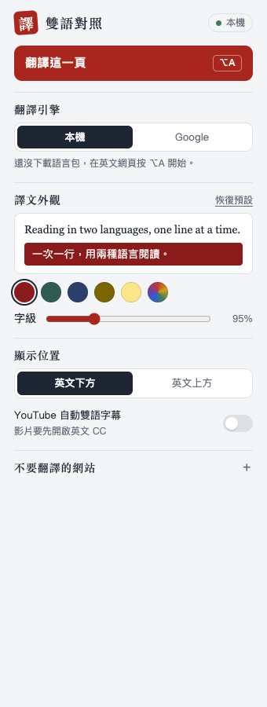
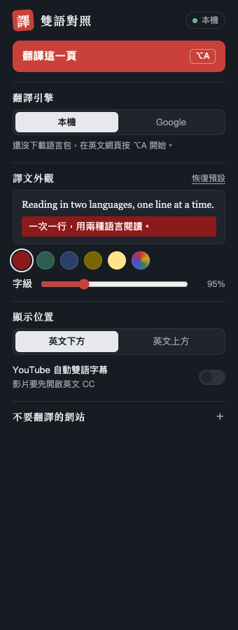
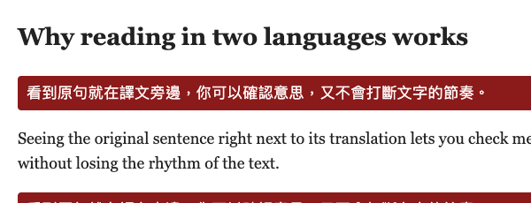

# 雙語對照翻譯（Chrome 擴充套件）· 開發說明書

個人自用的 Chrome 擴充套件，類似「沉浸式翻譯」：

- **網頁雙語對照**：英文段落的上方或下方插入中文譯文，底色和字級可以調整
- **YouTube 即時雙語字幕**：讀取英文 CC，在播放器上畫出「英文＋中文」雙語字幕框

| 項目 | 內容 |
|------|------|
| 版本 | 0.7.0 |
| 平台 | Google Chrome 138+（桌面版），開發環境為 Mac mini M4 + Chrome 157 |
| 技術 | Manifest V3、原生 JavaScript、零第三方執行期依賴 |
| 翻譯引擎 | **預設本機**：Chrome 內建 Translator API，文字不離開電腦；可改用 Claude（自己的 API 金鑰）或 Google gtx，都要手動授權 |
| 第三方程式碼 | 只有 `vendor/anthropic-sdk.js`（官方 Anthropic SDK 1.3.0，打包成單一檔案，見 §4.4） |
| 資安設計 | 見 [`SECURITY.md`](SECURITY.md) |
| 設計決策與變更紀錄 | 見 [`DEV_JOURNAL.md`](DEV_JOURNAL.md) |

| 設定彈窗 | 深色模式 | 網頁對照 |
|---|---|---|
|  |  | <br><br> |

---

## 1. 安裝

1. 打開 `chrome://extensions`，開啟右上角的「開發人員模式」
2. 點「載入未封裝項目」，選擇這個專案資料夾
3. 開一篇英文網頁，按 `Alt+A`。第一次使用時，右下角會出現「下載並翻譯」，按下去下載英翻繁中語言包（只需一次）
4. （選用）想改用 Google 翻譯：彈窗 →「翻譯引擎」選 Google →「允許使用」→ Chrome 跳出對話框時按允許

> 改過程式碼之後，要在 `chrome://extensions` 按擴充卡片上的 ↻ 重新載入，再重新整理網頁。

## 2. 使用

### 網頁
- 按工具列圖示 →「翻譯此頁 / 還原」，或按快捷鍵 **`Alt+A`**（Mac 是 `Option+A`）
- 再按一次會還原
- 快捷鍵可以在 `chrome://extensions/shortcuts` 修改

### YouTube
- 在彈窗勾選「YouTube 自動雙語字幕」
- 影片要先開啟**英文 CC**（手動字幕或自動字幕都可以）
- 也可以在 YouTube 頁面按 `Alt+A` 只切換這一頁

### 工具列徽章
| 徽章 | 意思 |
|------|------|
| `ON`（綠） | 這一頁正在翻譯 |
| `↓`（藍） | 本機語言包還沒下載，請按頁面右下角的「下載並翻譯」 |
| `✕`（紅） | 被拒絕：敏感網站、黑名單，或頁面上有密碼欄位 |
| `!`（紅） | Google 模式還沒授權、瀏覽器不支援本機翻譯，或這一頁無法執行（例如 Chrome 線上應用程式商店） |

### 翻譯引擎
| | 本機（預設） | Claude（選用） | Google（選用） |
|---|---|---|---|
| 技術 | Chrome 內建 Translator API（`en → zh-Hant`） | 你自己的 Anthropic API 金鑰（Opus 5.5 / Haiku 5.5） | `translate.googleapis.com` gtx 端點 |
| 資料去向 | **不離開電腦** | 送到 Anthropic | 送到 Google 伺服器 |
| 費用 | 免費 | 依用量計費，彈窗顯示當天估算 | 免費 |
| 品質 | 小模型 `[推測]` | 最好，會照語境用台灣用語 | 一般 |
| 限流 | 沒有 | 依你帳號的額度 | 翻太多會被暫時限流 |
| 首次使用 | 在網頁上點一次「下載並翻譯」 | 在彈窗貼金鑰並允許連線 | 在彈窗允許連線 |
| 請求方式 | 依序處理（併發 1） | 同一頁的段落合併成一次請求 | 每段一次（併發 4） |

- 引擎之間不會自動切換。本機失敗時**不會**偷偷改用線上引擎，要你自己在彈窗切換
- 本機模式下，background 會拒絕所有線上翻譯請求，就算是切換前開的舊分頁送來的也一樣

### Claude 引擎
1. 到 Anthropic Console 建立 API 金鑰。**建議另開一個 workspace 給這個擴充，並設定每月消費上限**，金鑰萬一外洩，損失也有上限
2. 彈窗 →「翻譯引擎」選 Claude → 貼上金鑰 → 「儲存金鑰」→ Chrome 跳出對話框時允許連到 `api.anthropic.com`
3. 按「測試金鑰」確認可以用（查詢模型資訊，不會產生費用）

| 項目 | 說明 |
|---|---|
| 模型 | Opus 5.5（預設，$4 / $20 每百萬 tokens）或 Haiku 5.5（$0.10 / $0.50）。一篇約 2,000 字的文章，Opus 大約 $0.07、Haiku 大約 $0.002 `[推測]` |
| 金鑰存放 | 預設只存在記憶體（`storage.session`），重開 Chrome 就消失。勾「記住金鑰」才存到 `storage.local`，而且鎖成只有擴充本身讀得到，網頁上的內容腳本讀不到 |
| 金鑰顯示 | 存好後只顯示 `sk-ant-…` 加末 4 碼 |
| 請求設定 | `effort: low`；用 structured outputs 取回 JSON；Opus 開啟伺服器端拒答備援（`fallbacks: "default"`），Haiku 沒有這個功能所以不帶 |
| 提示注入防護 | 系統提示明講頁面文字是要翻譯的資料，不是指令；譯文比原文長 4 倍以上就丟掉；譯文一律用 `textContent` 插入 |
| 用量 | 每次請求後記下當天次數與估算花費。實際費用以 Console 為準，啟用備援模型時費率可能不同 |
| YouTube | 字幕一次一句，無法合併請求，長片費用會比較高。用 Opus 一小時約 $3–4 `[推測]`，看 YouTube 建議切 Haiku |

### 彈窗設定
| 設定 | 預設 | 範圍 / 選項 | 存放位置 |
|------|------|-------------|----------|
| 翻譯引擎 | 本機 | 本機 / Claude / Google | `storage.sync` |
| Claude 模型 | Opus 5.5 | Opus 5.5 / Haiku 5.5 | `storage.sync` |
| Claude 金鑰 | 無 | — | `storage.session`，勾「記住」才放 `storage.local` |
| 底色 | 深紅 `#8b1a1a` | 任意 `#rrggbb` | `storage.sync` |
| 字級 | 95% | 70%–160% | `storage.sync` |
| 網頁譯文位置 | 英文下方 | 下方 / 上方 | `storage.sync` |
| YouTube 自動雙語字幕 | 關 | 開 / 關 | `storage.sync` |
| 自訂黑名單 | 空 | 一行一個網域 | `storage.local`（不同步） |

- 文字顏色不用設定，程式會依底色自動挑對比較高的黑色或白色
- 改底色或字級時，頁面上已經出現的譯文會**即時套用**，不需要重新翻譯

---

## 3. 架構

### 3.1 目錄
```
bilingual-translate-ext/
├── manifest.json        # MV3 宣告：權限、YouTube 靜態注入、快捷鍵
├── background.js        # service worker：按需注入、黑名單、本機模式擋線上請求、gtx 代理、快取
├── settings.js          # 設定的唯一來源：預設值、驗證、自動文字色（彈窗、內容腳本、background 共用）
├── content-shared.js    # 內容腳本共用層：window.BT、狀態、佇列、本機 Translator、線上翻譯封裝
├── content-page.js      # 網頁模式：找文字塊、懶翻譯、插入譯文
├── content-youtube.js   # YouTube 模式：讀 CC、畫雙語字幕框
├── content-index.js     # 入口：toggle()、引擎檢查、語言包下載提示條、啟停、設定監聽
├── style.css            # 注入頁面的樣式：譯文、YouTube 雙語框、下載提示條
├── popup.html / .css / .js  # 工具列彈窗
├── icons/               # 朱砂印圖示 16 / 32 / 48 / 128
├── docs/                # README 用的截圖
├── vendor/
│   └── anthropic-sdk.js # 官方 Anthropic SDK 1.3.0 打包檔（只給 background 用）
├── scripts/
│   └── build-vendor.sh  # 重新產生 vendor/anthropic-sdk.js
├── tests/
│   ├── unit-background.js   # 黑名單、引擎限制、訊息驗證單元測試（不需任何套件）
│   └── e2e.js               # Playwright + Chromium 端對端測試
├── README.md            # 本檔
├── SECURITY.md          # 威脅模型與資安規劃
└── DEV_JOURNAL.md       # 設計決策與變更紀錄
```

### 3.2 模組職責
| 模組 | 負責 | 不負責 |
|------|------|--------|
| `background` | 能不能注入（黑名單、權限）、本機模式拒絕線上請求、驗證訊息、gtx、快取、徽章 | 不碰頁面 DOM；不跑本機翻譯 |
| `settings` | 預設值、`sanitize()` 驗證、`textColorFor()`、`applyTo()` 套 CSS 變數 | 不讀寫頁面內容 |
| `content-shared` | 狀態、佇列（本機併發 1、線上 4）、節流、本機 Translator、`translate()` 依引擎分流 | 不知道網頁或 YouTube 的結構 |
| `content-page` | 找最內層文字塊、IntersectionObserver、插入網頁譯文 | 不處理 YouTube |
| `content-youtube` | 讀字幕行、合併逐字更新、維護雙語框 | 不處理一般網頁 |
| `content-index` | `toggle()`、引擎檢查、下載提示條、start/stop、密碼欄位檢查、監聽設定 | 不含 DOM 掃描邏輯 |
| `popup` | 觸發翻譯、選引擎、顯示語言包狀態、授權 Google、外觀與黑名單 | 不碰頁面 DOM |

### 3.3 內容腳本載入順序（重要）
內容腳本不能用 `import`，模組之間靠全域命名空間（`window.BT`、`window.BT_SETTINGS`）和**載入順序**串起來：

```
settings.js → content-shared.js → content-page.js 或 content-youtube.js → content-index.js
```

這個順序寫在兩個地方，**改的時候兩邊都要改**：
- `manifest.json` 的 `content_scripts[0].js`（YouTube 靜態注入）
- `background.js` 的 `SCRIPT_FILES`（一般網頁按需注入）

每個檔案開頭都有「已載入就 return」的防護，因為每按一次 `Alt+A` 都會重新注入。

### 3.4 資料流

```
【一般網頁】
點工具列 / Alt+A
  → background.toggleTab()
      ├─ isDenied(url)？                → 徽章 ✕，結束（完全不注入）
      ├─ Google 模式但沒有權限？         → 徽章 !，結束
      └─ scripting.executeScript 注入 → BT.toggle()
            ├─ 有密碼欄位？              → 'blocked'
            ├─ 本機模式：Translator.availability()
            │    ├─ unsupported / unavailable → 'local-unavailable'（徽章 !）
            │    ├─ downloadable / downloading → 頁面右下角提示條（徽章 ↓）
            │    │     └─ 使用者在頁面上點「下載並翻譯」→ Translator.create(monitor) → start()
            │    └─ available → start()
            └─ start()
                 → Settings.applyTo(<html>)  套外觀 CSS 變數
                 → 掃描最內層文字塊 → IntersectionObserver（視窗附近才翻）
                 → 佇列 → translate()
                      ├─ 本機：translator.translate()（在內容腳本執行，不經 background）
                      └─ 線上：sendMessage → background：本機模式就拒絕 → 驗證 → 配額 → 快取 → gtx
                 → textContent 插入 .bt-zh

【YouTube】
manifest 靜態注入（只限 www.youtube.com）
  → youtubeAuto 開啟時 start()
  → MutationObserver（150ms 節流）讀 .caption-visual-line
  → 英文：直接鏡像到 .bt-yt-en（無延遲）
  → 中文：換句立刻翻；逐字增加時等停頓 0.7 秒，最多等 2.5 秒
  → 結果只接受「最新一次請求」→ .bt-yt-zh

【設定變更】
popup → storage.sync → content-index onChanged
  ├─ 底色 / 字級  → 只重套 CSS 變數（即時）
  ├─ 位置 / 引擎  → stop + start
  └─ youtubeAuto → YouTube 頁面啟停
```

### 3.6 本機語言包下載為什麼要在網頁上點
語言包還沒下載時，`Translator.create()` 需要**該頁面的使用者手勢**（transient user activation）。工具列、快捷鍵、彈窗都不算該頁面的手勢，所以第一次只能在頁面上放一顆按鈕讓你點。

- 提示條是內容腳本用 `createElement` + `textContent` 建的，網頁腳本模擬的點擊（`isTrusted: false`）不會產生使用者手勢，所以網頁沒辦法偷偷觸發下載
- 下載中再按一次 `Alt+A` 或按「取消」都可以關掉提示條
- 語言包下載一次之後是否所有網站共用，還要在你的 Chrome 上確認 `[待驗證]`

### 3.5 YouTube 雙語框為什麼要自己畫
原本把中文塞進 YouTube 自己的字幕框，但自動字幕是**逐字**長出來的。每多一個字整個框就重排一次，中文剛出現就被下一行英文推上去，而且每個半句都送一次翻譯，很快就被 Google 限流。

現在的做法：
1. 原生字幕設成 `opacity: 0`（還留在 DOM 裡，可以讀英文）
2. 在 `#movie_player` 裡畫自己的框，以 `bottom` 定位、往上長。中文是最後一個元素，**固定貼在底部**，英文變兩行時只會往上長
3. 控制列自動隱藏時（`.ytp-autohide`），框會跟著往下移，跟原生字幕一致
4. 字級跟著播放器寬度縮放（`--bt-yt-base`），一般、劇院、全螢幕模式都適用

---

## 4. 開發流程

### 4.1 改程式碼
1. 修改檔案
2. 在 `chrome://extensions` 重新載入擴充
3. 重新整理要測的網頁（舊頁面上的內容腳本已經失效）
4. 跑測試（見 4.3）
5. 更新 `DEV_JOURNAL.md` 的變更紀錄，有架構變動也要更新本檔
6. 有功能變動就調整 `manifest.json` 的 `version`

### 4.2 規範
- 註解一律繁體中文，只寫「為什麼」：決策、踩過的坑、業務規則
- 插入頁面的內容**只能用 `textContent`，禁止 `innerHTML`**。commit 前檢查：
  ```bash
  grep -n innerHTML *.js
  ```
- 不准 `try/catch` 吞錯誤，至少要 `console.error`；log **不准印原文**
- 從 `storage` 讀出的設定一律先過 `Settings.sanitize()`
- 新增設定：在 `settings.js` 的 `DEFAULTS` 和 `sanitize()` 各加一筆，其他地方不寫預設值
- Commit 訊息格式見全域規則（`type(scope): subject`）

### 4.3 測試

**單元測試**（黑名單、本機模式擋線上請求、訊息驗證、配額；不需安裝任何套件）
```bash
node tests/unit-background.js
```

**端對端測試**（79 項；需要 Playwright 和它附的 Chromium）
```bash
PLAYWRIGHT_PATH=/path/to/node_modules/playwright node tests/e2e.js
```

e2e 的做法：
- 每次執行都把擴充複製到暫存目錄，**只改 manifest 權限**，其他程式碼跟正式版一樣。原因是自動化點不到工具列，也按不到權限對話框
- 測試頁面用 `context.route` 攔截假網域（`article.test`、`login.test`、`mybank.test`、`www.youtube.com`）
- 線上引擎換成假的（回傳「測試譯文：…」），不依賴外部服務，也不會被 Google 限流
- 本機引擎用 `fake-translator.js` 模擬（測試時才產生，不在 repo 裡），**照真的 API 要求使用者手勢才能下載**，所以能驗證提示條的點擊流程
- 品牌版 Google Chrome 137 之後不支援 `--load-extension`，所以只能用 Chromium 測

**自動化測不到，要手動確認的**
- 真正的工具列點擊、`Alt+A`、Google 權限對話框
- **真的語言包下載**：Chromium 的內容腳本有 `Translator` API，也會回報 `downloadable`，但無頭模式下載一直不會完成（試過拿掉 `--disable-component-update` 也一樣）
- 真實 YouTube 的 DOM 結構（e2e 用的是仿造頁面）
- 在品牌版 Google Chrome 上的表現
- 真的 Claude API 呼叫：e2e 換掉了 SDK client，避免花錢也避免依賴網路。另外用真的 SDK 加攔截過的 `fetch` 確認過送出的網址、標頭與內容（SDK 1.x 把 API 金鑰放在 `Authorization: Bearer`，這是官方 SDK 的設計）

### 4.4 第三方程式碼（vendor）
`vendor/anthropic-sdk.js` 是官方 `@anthropic-ai/sdk` **1.3.0** 用 esbuild 0.28.2 打包成的單一 IIFE 檔，沒有壓縮，可以直接打開檢查。

- 固定版本，而且選發佈超過兩週的版本
- 安裝時加 `--ignore-scripts`，不執行套件的安裝腳本
- 打包檔裡實際連線的網域只有 `api.anthropic.com`，沒有 `eval` 或 `new Function`
- SHA-256：`de28b18dc802fbf5b91a2cce6a19237699c804b48f1a7acb6590513e06a70c90`

重新產生（升級時把腳本裡的版本號改掉，再更新上面的 SHA-256）：
```bash
./scripts/build-vendor.sh
```

---

## 5. 疑難排解

| 症狀 | 可能原因 | 處理 |
|------|----------|------|
| 徽章 `↓` | 本機語言包還沒下載 | 按頁面右下角「下載並翻譯」 |
| 下載一直停在 0% | 網路問題，或 Chrome 元件更新被公司政策或防火牆擋住 | 等一下再試；不行就在彈窗改用 Google |
| 徽章 `!`（本機模式） | 這個 Chrome 不支援本機英翻繁中 | 更新 Chrome，或在彈窗改用 Google |
| 徽章 `!`（Google 模式） | 還沒允許 Google 翻譯 | 彈窗 →「允許使用」 |
| 徽章 `!`（Claude 模式） | 沒有金鑰，或沒允許連到 Anthropic | 彈窗貼上金鑰並儲存；重開 Chrome 後沒勾「記住」的金鑰要重貼 |
| Claude 模式翻不出來 | 金鑰無效、額度用完或被限流 | 彈窗按「測試金鑰」看原因；到 Console 檢查額度 |
| Google 模式有 `ON` 但譯文不出現 | **Google 限流**：請求被 302 轉到 `google.com/sorry` | 等幾個小時，或改回本機引擎 |
| 本機翻譯品質不理想 | 本機模型比線上小 `[推測]` | 需要時改用 Google |
| 某個網站一直 `✕` | 在內建黑名單、網域含 `bank`，或頁面有密碼欄位 | 這是刻意的設計，見 `SECURITY.md` |
| YouTube 沒有雙語框 | 沒開英文 CC，或沒勾「自動雙語字幕」 | 開 CC，勾選設定 |
| YouTube 中文延遲 | 自動字幕逐字長出來時，會等停頓才翻 | 正常行為；可以調 `content-youtube.js` 的 `STABLE_MS`、`MAX_WAIT_MS` |
| 改了程式沒反應 | 沒重新載入擴充或網頁 | 見 4.1 |

檢查是否被限流（回 `200` 正常，回 `302` 代表被限流）：
```bash
curl -s -o /dev/null -w "%{http_code}\n" -X POST 'https://translate.googleapis.com/translate_a/single?client=gtx&sl=en&tl=zh-TW&dt=t' --data-urlencode 'q=hello'
```

---

## 6. 路線圖
| 階段 | 內容 | 狀態 |
|------|------|------|
| Phase 1 | 權限最小化、黑名單、訊息驗證、log 清理 | ✅ v0.3.0 |
| — | 底色、字級可調；YouTube 雙語框重做 | ✅ v0.4.0 |
| Phase 2 | Chrome 內建 Translator API（本機離線，文字不出機器），gtx 降為選用 | ✅ v0.5.0（真的語言包下載待在 Chrome 上驗證） |
| — | 介面重新設計、朱砂印圖示 | ✅ v0.6.0 |
| — | Claude 引擎（自己的 API 金鑰） | ✅ v0.7.0（真的 API 呼叫待你用自己的金鑰驗證） |
| Phase 3 | 擴充搬到內建 APFS 磁碟、譯文改用 Shadow DOM（選做） | 規劃中 |
